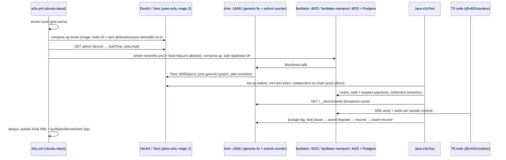

# Devnet E2E Suite Implementation Plan

**Tier:** R1 — tests and CI only; no production code change.
**Base:** `97add9f` (main) · **Spec review:** round 1 CHANGES REQUIRED (6 blockers) → round 2 CHANGES REQUIRED (2 blockers: shared journal, empty-nonce code) → round 3 **APPROVED** → Linux spike moved DevKit into compose; round 4 **APPROVED**

## Goal (from brief)

A GitHub Actions job runs on every PR and every push to `main`. It builds the
facilitator Docker image and starts it with Postgres against a Yaci DevKit devnet
posing as `cardano:preview` (magic 2, slot-config override). Black-box e2e suites
in Java (cardano-client-lib) and TypeScript (`@x402/cardano` 2.26.0) send real
signed transactions to every HTTP route and assert spec-conformant responses.

## Scope and constraints

- Black-box: the suites talk only to the facilitator HTTP API, the devnet chain
  API (funding, setup, independent proof, queried on **Yano directly, not through
  the shim**), the shim's test-only submit counter, and Docker (outage test only).
- The image under test is built from the PR's `Dockerfile`, unchanged.
- Tests pin the **current** behaviour as the contract. Where code and `docs/api.md`
  disagree, the code is pinned and the gap is listed (see Unsure). No test is
  weakened to pass.
- One command runs it locally (`e2e/run.sh`). CI calls the same script.

## Spike evidence (2026-10-26, local macOS arm64, DevKit 0.12.0)

| Probe | Result |
|---|---|
| DevKit `protocolMagic=2`, default `companion` mode | ✗ Haskell node dies: Byron `InvalidCertificate` |
| `PROTOCOLMAGIC=2 NODEMODE=yano-only` | ✓ chain runs, genesis `network_magic: 2` |
| Facilitator → bundled yaci-store `:8080/api/v1` | readiness UP, verify ✓, tx lands on-chain, but settle stays pending: `/txs/{hash}` has no `block`/`valid_contract`. `/api/v1/blockfrost/*` not bundled (404) |
| Facilitator → Yano `:6060/api/v1` | ✗ readiness DOWN: Yano `/genesis` returns `system_start` as an ISO string. Blockfrost and cardano-client-lib expect an integer, so Jackson throws `InvalidFormatException` |
| Facilitator → **shim** (rewrites only genesis `system_start`) → Yano | ✓ readiness UP, verify `isValid:true`, settle `confirmed` (2 confs), local hash independently found in a block |
| Yano `/mempool/{hash}` | 404 for an already-included tx (not probed while pending) |
| **Linux** (`linux/amd64` containers, one Docker network): npm DevKit 0.12.0 in `node:22-bookworm`, shim, Postgres, and the image built from the repo `Dockerfile` | First attempt ✗: the node image's `NODE_VERSION=22.23.4` is read by DevKit as `node.version`, so the cardano-node download returns 404. With it unset ✓: Yano is up in ~100 s (emulated) and still returns the ISO `system_start` (bundled Yano `0.1.0-pre17`). Readiness UP in 38 s; verify ✓; settle `confirmed` (2 confs); independent on-chain proof ✓; round trip ~9 s |

## Summary

An `e2e/` harness starts a DevKit devnet (`yano-only`, magic 2). It puts a small
genesis shim in front of Yano's Blockfrost-compatible API. The shim also counts
`POST /tx/submit` per tx so tests can prove there was exactly one broadcast. The
harness then runs Postgres and **two** instances of the PR-built image via Compose:
`facilitator` with defaults, and `facilitator-mempool` with `accept-mempool=true`
on its own Postgres **database**. The schema is hardcoded, so `DB_SCHEMA` can't
isolate them.
Running two instances is the only way to pin both `l1Confirmations:-1` behaviours.
Masumi deployment params and their script hash are fixed harness constants, so the
allowlist exists before the facilitators start.

The **Java suite** is a new Gradle source set, `e2eTest`, run with JUnit 5. It
covers routes, every devnet-reachable error code (single mutations of real funded
payments, each with a valid-base control), settlement semantics, script and Masumi
vectors, and a chain outage. A coverage gate fails the build when an `ErrorCodes`
constant has neither a covering test (whose source contains that code) nor a
written exclusion.

The **TS suite** pays through the published `@x402/cardano` client and
`HTTPFacilitatorClient` for each transfer method, an independent implementation that
serves as oracle. A first smoke version of `e2e.yml` lands with WP-1, so the Linux
networking path is proven early. WP-8 completes it.

## Diagram — one CI run



## Change map

```
.github/workflows/
  e2e.yml                                   +90   smoke (WP-1) → full (WP-8)
e2e/
  run.sh                                    +80   one-command entry; main pass, then @Tag("outage") pass
  devnet/Dockerfile                         +15   node:22-bookworm + pinned npm DevKit (NODE_VERSION unset)
  devnet/devnet-up.sh, devnet-down.sh       +85   compose orchestration + wait
  devnet/render-networks.py                 +40   NETWORKS_FILE from admin API + constants
  devnet/masumi-deployment.json             +10   fixed params + precomputed script hash
  shim/yano_genesis_shim.py                 +70   genesis fix + submit counter
  compose.e2e.yml                           +70   postgres, shim, facilitator, facilitator-mempool
  coverage/wp-{3,4,5,6}.yml                 +100  per-package coverage fragments
  ts/package.json, package-lock.json        +20   pinned SDKs
  ts/sdk-flows.test.mjs                     +250
src/e2eTest/java/org/cardanofoundation/x402/facilitator/e2e/
  kit/{DevnetKit,FacilitatorClient,PaymentFactory,SchemaAssert,ShimClient}.java  +500
  RoutesE2ETest.java                        +170
  DefaultTransferE2ETest.java               +200
  SettlementSemanticsE2ETest.java           +220
  RejectionMatrixE2ETest.java               +320
  ScriptTransferE2ETest.java                +150
  MasumiTransferE2ETest.java                +280
  ChainOutageE2ETest.java                   +110
  ErrorCodeCoverageTest.java                +80
src/e2eTest/resources/schema/*.json         +200
build.gradle                                +25   e2eTest source set + task only
docs/testing.md, README.md                  ~45
docs/work/STATUS.md, docs/work/wp-*.md            bookkeeping
```

No ⚠ entries: no schema, auth, concurrency, public-API or module-boundary change.

## Risk table

| # | Change | Risk | Why | Review this |
|---|---|---|---|---|
| 1 | Shim | High | It sits between the SUT and the chain. Over-rewriting would hide real incompatibilities. Must be threaded, recompute `Content-Length`, handle gzip. | Read line-by-line; only `GET …/genesis`.`system_start` changes |
| 2 | Rejection matrix + coverage gate | High | This is where "all vectors" is claimed. A mutation can trip an earlier check than the one it names. | Read line-by-line; every case has a valid-base control and asserts the exact reason |
| 3 | Masumi vectors + fixed deployment | Med | Java builders reuse main-code helpers (shared-bug blind spot); the TS SDK is the independent oracle | Read the oracle split and the hash-consistency test |
| 4 | `e2e.yml` | Med | PR-triggered; no secrets; flake budget | Read |
| 5 | Settlement/outage timing | Med | 1 s blocks; 5 s health cache; paused container makes calls hang, not fail | Read the waits (condition-based, deadlines > provider timeout) |
| 6 | `build.gradle` source set | Low | Must not change `test`/`bootJar` | Skim |
| 7 | Schemas, docs, scripts | Low | — | Skim |

## Acceptance criteria

- [ ] `e2e.yml` triggers on `pull_request` (opened, synchronize, reopened), `push: main` and `workflow_dispatch`; `timeout-minutes: 30`; no secrets; any failure fails the check.
- [ ] `e2e/run.sh` passes on macOS arm64 (amd64 image emulated) **and** on `ubuntu-latest`. The Linux run is proven by WP-1's smoke workflow, not deferred to WP-8.
- [ ] Routes: `POST /verify`, `POST /settle`, `GET /supported`, `GET /health`, `/actuator/health`, `/actuator/health/{liveness,readiness}`, `/actuator/info`, `/actuator/prometheus` each have an asserted status and body. `X-Correlation-Id` echo is pinned. Every 2xx `/verify`, `/settle` and `/supported` body validates against its schema.
- [ ] Transport: malformed JSON → 400, missing fields → 400, body > 64 KiB → 413, unknown network/version → 500. Wrong method, wrong content type and unknown path → 500 `internal_error`, pinned and listed under Unsure.
- [ ] Positive vectors, each settled and **independently** found on-chain via direct Yano lookup of the local hash: default ADA, default native token, default with aux metadata, overpay, script (`extra.script` with and without params, `extra.scriptHash`, V2 and V3), Masumi ADA, Masumi token.
- [ ] Settlement on `facilitator`: policies 0/1/3 → `confirmed`, `confirmations ≥ n`; `-1` → `confirmed` after inclusion. On `facilitator-mempool`: `-1` → `success:true`, `status:mempool`, `confirmations:-1`, and `/supported` minimum `-1` (default instance: `0`).
- [ ] Settlement idempotency: re-settling the same payload → `success:true` again. Same tx with different requirements → `duplicate_settlement`. Verify after settle → `…nonce_not_on_chain`. Two concurrent settles → shim counter shows exactly **1** `POST /tx/submit` for that hash, and both responses converge.
- [ ] Chain outage (runs last): after `/health` reaches 503, readiness is DOWN and liveness UP. Verify → `exact_cardano_facilitator_chain_lookup_failed`. A fresh settle → 503. Re-settling an already-confirmed payload → 200 `settlement_pending`. After resume, readiness is UP and a new settle confirms.
- [ ] `ErrorCodeCoverageTest` (no stack needed) passes. Every `ErrorCodes` constant, keyed by **constant name**, maps to test ids whose source contains that constant's string, or to an exclusion with an accurate reason. Adding an unmapped constant fails.
- [ ] TS suite: for default ADA, token, script, Masumi ADA and Masumi token, an `x402ResourceServer` requirement is paid by the `@x402/cardano` client and verified and settled through `HTTPFacilitatorClient` against the container.
- [ ] Sabotage proof: an image built from a throwaway patch that removes one check fails the Java suite on exactly that case (recorded in the WP-4 log; patch discarded).
- [ ] `./gradlew test` and `interop` unchanged and green.

## Decisions most likely to be wrong

1. **Test-only genesis shim instead of fixing the facilitator.** This keeps the
   image identical to what ships; the facilitator reads only `network_magic` from
   genesis (`BlockfrostChainService.java:83-85`) and takes its clock from
   `slot-config`. The cost: the suite can't catch this incompatibility, and your
   `yano` compose profile may already be broken by it (unverified; it pins Yano
   `0.1.0-pre11`). Alternative: read `network_magic` from raw JSON in production,
   as a separate fix. Report the format bug to Yano (you post).
2. **Masumi oracle split.** Java Masumi vectors are built with main-code helpers
   plus `MasumiTestSeller`; positive correctness comes from the TS SDK. If the
   2.26.0 client can't build a live Masumi lock (WP-7 spikes this first), positive
   Masumi coverage rests on the Java builder alone.

## Tasks and ownership

Order: WP-1 → WP-2 → {WP-3, WP-4, WP-5, WP-6} → WP-7 → WP-8. WP-7 needs only WP-1.
Every file has exactly one owner. Coverage uses per-package fragments
(`e2e/coverage/wp-N.yml`) that WP-4's gate merges. WP-1 owns `run.sh`, the outage
pass, the shim and the Masumi constants.

### Task 1 — The stack comes up green with one command on macOS and Linux (check: `e2e/run.sh --smoke` locally + smoke `e2e.yml` green on ubuntu) → [wp-1](../work/wp-1-devnet-harness.md)
### Task 2 — Every route has a pinned contract (check: `*RoutesE2ETest`) → [wp-2](../work/wp-2-java-kit-and-routes.md)
### Task 3 — Default transfers and settlement semantics are proven on-chain (check: `*DefaultTransferE2ETest`, `*SettlementSemanticsE2ETest`) → [wp-3](../work/wp-3-default-and-settlement.md)
### Task 4 — Every devnet-reachable code is asserted and coverage is gated (check: `*RejectionMatrixE2ETest`, `*ErrorCodeCoverageTest`, sabotage run) → [wp-4](../work/wp-4-rejection-matrix.md)
### Task 5 — Script and Masumi methods are proven on-chain (check: `*ScriptTransferE2ETest`, `*MasumiTransferE2ETest`) → [wp-5](../work/wp-5-script-and-masumi.md)
### Task 6 — Chain outage degrades and recovers as specified (check: `*ChainOutageE2ETest`) → [wp-6](../work/wp-6-chain-outage.md)
### Task 7 — The published TS SDK pays through the container for every method (check: `e2e/run.sh --ts`) → [wp-7](../work/wp-7-ts-sdk-flows.md)
### Task 8 — CI runs it all on PR and push to main (check: full `e2e.yml` green on a PR) → [wp-8](../work/wp-8-workflow-and-docs.md)

## Assumed / Unsure / Skipped

**Assumed**
- GitHub's `ubuntu-latest` behaves like the local `linux/amd64` container spike. WP-1's smoke workflow confirms this on real runners.
- `--enable-yaci-store` can be dropped (WP-1 confirms).
- Paying *to* script and Masumi addresses needs only outputs. Script *spending* is rejected without a phase-1 validator, so none is tested.

**Unsure (ranked)**
1. Whether the `@x402/cardano` 2.26.0 client builds live Masumi/script payments against a provider (WP-7, decision 2).
2. (Resolved by the Linux spike: DevKit now runs as a compose service, so there is no host networking.) The remaining risk is the speed of GitHub's runners, which are native x64 and should be faster than my emulated run.
3. Yano is a Java ledger: "accepted by Yano" is weaker than "accepted by cardano-node". The `Rejected` regex (`BlockfrostChainService.java:241`) probably never matches Yano's error text, so ledger-rejection classification is untested here.
4. Whether your production `yano` profile has the same `system_start` bug.
5. CI wall time estimate 15–25 min. Above 30, split jobs.
6. Code/docs gaps the suite pins on the code side, for you to rule on:
   - `docs/api.md:402` documents 401/429 filters that don't exist.
   - The `ApiErrorAdvice` catch-all turns 405/415/404 into 500 `internal_error`.
   - Default `/supported` advertises a minimum of `0` while verify accepts `-1`.
   - `DB_SCHEMA` / `spring.flyway.schemas` in `application.yml` is dead config: `FlywayConfig` hardcodes the `facilitator` schema.

**Skipped** (as exclusions in the coverage fragments, with reasons)
- **Race-only:** `definitively_rejected` on submit, `duplicate_settlement` at the claim races.
- **Provider-fault beyond a full outage:** `input_value_unavailable`, `NotSubmitted` → `settlement_failed`.
- **`settlement_failed` "expired":** needs a submitted tx that never lands, which a healthy devnet can't produce. Covered offline by `ExactCardanoSettleTest`.
- **Unreachable via HTTP:** `unsupported_version` (the registry returns 500 first).
- **Dead constants:** `SUBMISSION_MODE_MISMATCH`, `SUBMISSION_MODE_UNSUPPORTED`, `EVIDENCE_MISSING`, `SETTLEMENT_NOT_CONFIRMED`, `CLIENT_SCRIPT_EXECUTION`. The last one shares its string with `PHASE2_INVALID`, so the manifest is keyed by constant name.
- **Out of scope:** a "raw Yano → readiness DOWN" known-incompatibility test, preprod/mainnet, load testing, the `full`/`yano` compose profiles.
- **red-first in its usual form:** these are characterization tests, green at base by design. WP-4's sabotage run replaces it.
