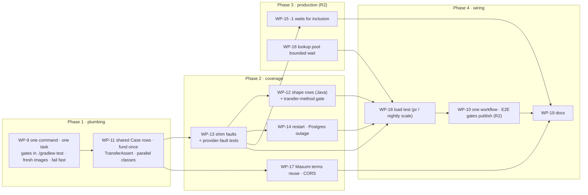

# Test pipeline target state — Implementation Plan

**Tier:** R2 overall. Most packages are R1 (test-only). WP-10 (release gate), WP-15 (settle depth, funds path) and WP-16 (process-wide concurrency) are R2: the orchestrator builds them, and `complexity-specialist` checks their invariants first.
**Base:** `8b481e2` on `feat/devnet-e2e-suite` (PR #8). Everything stays **staged**; nothing is committed or pushed.
**Target picture:** [2026-11-04-test-pipeline-target-state.md](2026-11-04-test-pipeline-target-state.md)

## Goal (from the brief)

| | |
|---|---|
| **Goal** | E2E gates publishing, and every proposed layer runs green on the devnet. Two production fixes (bounded lookup wait, `-1` depth) are each proven by a test that fails before the fix. Each concern has exactly **one way**: one command per environment, one Gradle task on the stack, one case format, one workflow file. |
| **Acceptance** | The criteria below, plus each package's `Check`. |
| **Non-goals** | Accepting unusual shapes (no `Phase1Validator` exists, so they stay `phase1_invalid`). Folding the TS suite into JUnit (it tests the JS SDK). Replacing the Python shim. Preprod in CI (it stays the manual `./gradlew preprodE2e`). Enabling Renovate or branch protection on GitHub. Any commit or push. |
| **Assumptions** | A Postgres outage fails closed, and the test checks that rule rather than exact status codes. The PR-scale load run takes about 2 minutes or less. Canary covers the TS SDK and DevKit; CCL bumps arrive as Renovate PRs, which run the full e2e. |
| **Your decisions** | Lookup pool: bounded wait. Docker: you raise the VM memory. Branch: staged on PR #8. **Case format: Java tables only** (no TxPlan YAML, no CCL 0.8). |

## One way each

| Concern | The one way | Replaces |
|---|---|---|
| Run without a stack | `./gradlew test`: unit tests **and** the coverage gates, moved to `src/test` | `e2eGate` task |
| Run on the devnet | `e2e/run.sh` → boot → Gradle `e2eTest` → TS `npm test` | 4 Gradle tasks, 7 run.sh modes |
| Keep disruptive tests apart | JUnit `@Isolated`: nothing runs alongside the class | tags + separate chaos/load passes |
| Write a devnet case | a `Case` row (build spec · optional defect · expected result) in a Java table | TxPlan YAML, load YAML profiles |
| Test runner | JUnit for all Java and the shim's self-test; Node's runner only for the TS SDK suite | Python unittest |
| CI | one workflow, `build.yml`: verify · e2e · publish; a `schedule` trigger runs full-scale load + canary | `e2e.yml`, `nightly.yml` |
| Size of load | the same `LoadE2ETest`, `E2E_LOAD_SCALE=pr` (default) or `nightly` | a separate nightly-only suite |

`run.sh` flags: `--up` (boot and keep, run nothing), `--keep` (leave the stack running), `--reuse` (use a running stack, boot only if none). Any other arguments are Gradle filters: with filters, only the Java suite runs.

## Global constraints

- **Tests are immutable.** No existing assertion is removed or weakened, and no test is skipped. Refactors (WP-11) keep every check and message identical. Existing test files change only in these stated ways:
  - `ErrorCodeCoverageTest` moves to `src/test` unchanged (WP-9).
  - `ChainOutageE2ETest` swaps `@Tag("outage")` for `@Isolated` (WP-9), a scheduling change.
  - Rejection and Masumi cases become shared `Case` rows with identical checks (WP-11).
  - Two `wp-4.yml` exclusions become tests (WP-13).
- **New tests never assert today's behaviour blindly.** Every expected result below cites the code that defines it. If the facilitator disagrees, the builder stops and reports.
- Code style: Lombok where it fits, never `var` (Java). The shim stays stdlib-only Python on `python:3.12-alpine`.

## Summary

Four phases:
1. **Plumbing.** WP-9 reduces running to `./gradlew test` plus `e2e/run.sh`, with one stack task, fresh images and fail-fast boot. WP-11 introduces the shared `Case` type, fund-once wallets and parallel classes.
2. **Coverage.** All as `Case` rows or plain JUnit classes:
   - WP-13: shim faults and provider-fault tests;
   - WP-12: new transaction shapes as Java rows, plus the transfer-method gate;
   - WP-17: Masumi terms reuse and CORS;
   - WP-14: restart and Postgres outage.
3. **Production.** WP-15 fixes the `-1` depth and WP-16 makes lookups wait. Each fix gets a test that fails first.
4. **Wiring.** WP-18 adds the load test, WP-10 puts all of CI in one workflow with publish gated on E2E, and WP-19 updates the docs.

You can build packages in parallel, but each devnet verification runs alone: one stack, and fixed ports.

## Diagram — package order and dependencies



WP-16's unit-level work can start any time; its load proof waits for WP-13's latency profile. WP-12 follows WP-13 because both append to `e2e/coverage/wp-4.yml`.

## Change map

```
.github/workflows/
  build.yml                         WP-10  verify · e2e (inline) · publish needs both; schedule → nightly scale + canary
  e2e.yml                           WP-10  deleted (folded into build.yml)
renovate.json                       WP-10  new
build.gradle                        WP-9   one e2eTest task, no tag/result properties; test task declares the gates' file inputs; preprod task renamed
.dockerignore                       WP-9   exclude src/e2eTest
e2e/
  run.sh                            WP-9   one flow; --up/--keep/--reuse; fresh images; fail fast; E2E_CANARY
  compose.e2e.yml                   WP-17  CORS origins on facilitator-mempool
  shim/yano_genesis_shim.py         WP-13  fault + profile control API
  coverage/wp-4.yml                 WP-13  2 exclusions become tests, 1 reason sharpened
                                    WP-12  append shape tests to existing entries
  coverage/wp-{12,13,17}.yml        new    per-package fragments
  coverage/transfer-methods.yml     WP-12  new manifest
src/test/java/.../e2e/
  ErrorCodeCoverageTest.java        WP-9   moved from src/e2eTest, unchanged
  TransferMethodCoverageTest.java   WP-12  new stackless gate
src/e2eTest/java/.../e2e/
  kit/Case.java                     WP-11  new: the one case format
  kit/Funding.java                  WP-11  new
  kit/TransferAssert.java           WP-11  new
  kit/MasumiLock.java               WP-11  moved out of MasumiTransferE2ETest
  kit/PaymentFactory.java           WP-11  customize, preBalance, nonceInput
  kit/ShimClient.java               WP-13  faults + profile
  kit/Stack.java                    WP-14  new: compose kill/start/stop/exec
  kit/IsolatedStackGuard.java       WP-11  new: after each @Isolated class, wait for both facilitators
                                    WP-13  … and clear shim faults/profile
  Default/Script/Masumi/Rejection/SettlementSemantics/RoutesE2ETest   WP-11  refactor to Case/Funding/TransferAssert
  ChainOutageE2ETest.java           WP-9   @Tag("outage") → @Isolated
  ShapeMatrixE2ETest.java           WP-12  new: shape rows
  ShimFaultsE2ETest.java            WP-13  new: shim self-test against the live shim
  ProviderFaultE2ETest.java         WP-13  new
  CrashRecoveryE2ETest.java         WP-14  new
  MempoolEvidenceE2ETest.java       WP-15  new
  MasumiTermsConflictE2ETest.java   WP-17  new
  CorsE2ETest.java                  WP-17  new
  LoadE2ETest.java                  WP-18  new
src/e2eTest/resources/junit-platform.properties   WP-11  new: parallel classes, extension autodetection
src/e2eTest/resources/META-INF/services/…Extension WP-11  new: registers IsolatedStackGuard
src/main/java/.../
  service/settlement/SettlementService.java  WP-15  -1 depth (funds path)
  chain/LookupBudget.java           WP-16  ⚠ concurrency — bounded queue
src/test/java/.../
  service/settlement/SettlementMempoolDepthTest.java   WP-15  new
  chain/LookupBudgetTest.java       WP-16  new methods only
docs/testing.md, README.md          WP-19
docs/configuration.md               WP-16  lookup concurrency limit
```

## Risk table

| # | Change | Risk | Why | Review this |
|---|---|---|---|---|
| 1 | WP-16 `LookupBudget` bounded queue | High | process-wide concurrency in production; queued-then-cancelled calls must never run late | Read line-by-line; `complexity-specialist` before; the existing 8-thread test passes unchanged |
| 2 | WP-15 `SettlementService` depth | High | settlement result on the funds path | Read line-by-line; unit and e2e tests red before the fix |
| 3 | WP-10 one workflow, publish gated | High | a flaky E2E blocks releases; provable only on GitHub | Read the workflow; measure flake rate before making the check required |
| 4 | WP-11 shared `Case` + parallel classes | Medium | refactor of 6 test classes; new concurrency in the suite | Diff assertions before/after: same checks, messages, test count; `@Isolated` where state is shared |
| 5 | WP-9/11 one task with `@Isolated` instead of separate passes | Medium | outage/chaos must never overlap other classes, and must leave both instances ready; isolated classes now run one after another on every PR (est. 8–10 extra minutes) | Check every disruptive class is `@Isolated`; check `IsolatedStackGuard`; run the suite 3×; record PR-path time |
| 6 | WP-10 single workflow concurrency | Medium | a shared group would let the schedule cancel a pending push (and its publish) | Check the group dedupes pull requests only |
| 7 | WP-13 shim faults | Medium | a buggy shim gives false greens or reds | Read the shim; faults opt-in, pass-through by default; `ShimFaultsE2ETest` proves it |
| 8 | WP-14 chaos | Medium | kills containers; must leave the stack healthy | Check every `finally` restores the stack |
| 9 | WP-12, WP-17, WP-18, WP-19 | Low | test-only or docs | Skim; trust after a green run |

## Acceptance criteria

- [ ] `./gradlew test` runs the unit suite plus `ErrorCodeCoverageTest` and `TransferMethodCoverageTest`, with no stack, and reruns when only `e2e/coverage`, `src/e2eTest/java` or `e2e/ts/test` change.
- [ ] `./gradlew tasks --all` shows exactly one devnet test task, `e2eTest`. `run.sh` has no modes besides `--up`, `--keep` and `--reuse`.
- [ ] `e2e/run.sh` is green: Java `e2eTest` (including the `@Isolated` outage, chaos, provider-fault and PR-scale load classes), then TS.
- [ ] A run after a source change rebuilds the facilitator image. A failed DevKit boot fails `run.sh` within 60 s, not 600 s.
- [ ] Every devnet transaction case is a `Case` row. No YAML case files and no CCL pre-release are on any classpath.
- [ ] The 142 existing Java tests keep their names and pass. Totals only grow.
- [ ] `wp-4.yml` no longer excludes `INPUT_VALUE_UNAVAILABLE` or `SETTLEMENT_DEFINITIVELY_REJECTED`. `SETTLEMENT_FAILED` stays excluded with the precise reason: verify and both reconcilers call `/blocks/latest`, so a submit-only fault can't be isolated.
- [ ] `MempoolEvidenceE2ETest` and `SettlementMempoolDepthTest` are red before WP-15's fix and green after.
- [ ] The new `LookupBudgetTest` methods are red at base and green after WP-16. The verify burst shows zero `chain_lookup_failed` at 64 concurrent calls with 150 ms latency.
- [ ] Restarting the facilitator mid-settle, or stopping Postgres, never produces a second broadcast (shim count ≤ 1), nor a `success: true` without inclusion.
- [ ] `LoadE2ETest` writes `e2e/.out/load/summary.json` at both scales and fails only on invariant violations.
- [ ] `.github/workflows/` contains only `build.yml`; `actionlint` is clean; `publish` needs `[verify, e2e]`; only pull requests share a concurrency group; the canary leg builds DevKit at a concrete resolved version and prints the version that ran.

## Tasks

| WP | Outcome (check) | Tier | Builder |
|---|---|---|---|
| [WP-9](../work/wp-9-run-and-gradle-tasks.md) | One command per environment, one stack task, fresh images, fail fast (`./gradlew test`, `e2e/run.sh` green) | R1 | builder |
| [WP-11](../work/wp-11-kit-funding-and-parallel.md) | Every devnet case is a shared `Case` row; tests fund from one fan-out; classes run in parallel (≥142 green, identical checks) | R1 | builder |
| [WP-13](../work/wp-13-shim-faults.md) | Provider failure paths are tested through shim faults (`ShimFaultsE2ETest`, `ProviderFaultE2ETest`) | R1 | builder |
| [WP-12](../work/wp-12-shape-rows.md) | New transaction shapes are one `Case` row each; a new transfer method fails the gate (`ShapeMatrixE2ETest`, `TransferMethodCoverageTest`) | R1 | builder |
| [WP-17](../work/wp-17-single-cases.md) | Masumi terms reuse and CORS are covered | R1 | builder |
| [WP-14](../work/wp-14-chaos.md) | A restart or Postgres outage never double-broadcasts (`CrashRecoveryE2ETest`) | R1 | builder |
| [WP-15](../work/wp-15-mempool-depth-fix.md) | `-1` waits for inclusion when mempool acceptance is off (red → green) | R2 | orchestrator |
| [WP-16](../work/wp-16-lookup-pool-wait.md) | The 9th concurrent lookup waits instead of failing (red → green, burst proof) | R2 | orchestrator |
| [WP-18](../work/wp-18-load-test.md) | One load test checks invariants at PR and nightly scale (`LoadE2ETest`) | R1 | builder |
| [WP-10](../work/wp-10-ci-gate.md) | One workflow; publish waits for E2E; the schedule runs nightly scale + canary (`actionlint`, then your push) | R2 | orchestrator |
| [WP-19](../work/wp-19-docs.md) | Docs describe the one way to run and write tests | R1 | builder |

## How the work is executed and proven

- **Prerequisite:** you raise the Docker VM memory (12 GiB or more) before WP-9's first devnet run. If DevKit still fails to boot, I stop and report.
- **One stack at a time.** Builders may write code in parallel, but every devnet run is serialized. `e2e/run.sh --reuse` keeps a healthy stack between runs; WP-14 and WP-18 run against a fresh one.
- **Scope with staged-only work:** nothing is committed, so `check-scope.sh` at base `8b481e2` sees every package's changes. Each package's `check-scope` runs against a scratch package file whose Allowed files are the union of all finished packages plus the current one, plus `docs/plans/2026-11-04-test-pipeline-*.md` and `docs/work/*.md`. The orchestrator owns `docs/work/STATUS.md` throughout.
- **Per-package review diff:** some files are shared across packages (`build.gradle`, `run.sh`, the refactored test classes). At each package start, the orchestrator copies the package's Allowed files that already differ from `HEAD` into the scratchpad. The diff `code-reviewer` reads is `diff -ru <snapshot> <current>` for those, plus `git diff HEAD` for files only this package touches. `git diff HEAD --stat` plus the untracked list is also saved at each boundary; any file that changed outside the current package's Allowed files fails the package.
- **Red first:**
  - Unit tests and gates (WP-12, WP-15, WP-16) use `~/.claude/bin/red-first.sh 8b481e2` with a `--baseline` that exists at base.
  - E2E tests can't run in red-first's throwaway worktree. Where an e2e test must be red (WP-15), it runs against the unfixed code first and the output is logged verbatim.
  - Characterization tests log `red-first: n/a (characterization)`.
- **Review:** one `code-reviewer` pass per package. WP-15 and WP-16 get a `complexity-specialist` pass on the invariant before the code is written.

## Deviations from the target-state doc

- **One way instead of several:** no TxPlan YAML, no CCL 0.8, no separate chaos/load/gate tasks, no `nightly.yml`, no Python unittest. The target-state doc is updated to match.
- **Coverage fragments are kept** (`wp-N.yml`) instead of one `coverage.yml`. Packages run in parallel, and one file would be a merge hotspot.
- **Exact-spend shape dropped.** "No change output" needs a hand-computed fee and adds little over the existing value checks.
- **Rollback asserts `pending` and no rebroadcast**, not CONFIRMED→SUBMITTED. Blockfrost gives no watermark (`SettlementService.java:190-193`).
- **`SETTLEMENT_FAILED` stays excluded.** A refused submit is classified Unknown, which means pending (`BlockfrostChainService.java:245`). NotSubmitted needs the submit-time tip check to fail, but verify and both reconcilers call the same endpoint (`:110-112`, `SettlementReconciler.java:55,97`).
- **"Submit swallowed → expired" is not asserted.** With a Blockfrost-compatible provider, `NotSeen` has no watermark (`InclusionResult.java:9`), so expiry can never be proven (`SettlementService.java:216-218`, `SettlementReconciler.java:135-137`).
- **"Null coin" becomes "UTxO without a lovelace entry".** A null quantity yields `chain_lookup_failed` (`BlockfrostChainService.java:204-205`).
- **`hide-tx` hides `/txs/<hash>` only**, so a `mempool` fault on the same hash still answers. WP-15's red run depends on it.
- **Postgres outage:** only the fail-closed invariants are asserted.
- **Preprod stays manual** (`./gradlew preprodE2e`), not a CI job.

## Findings for you (not fixed by this plan)

- **A swallowed or dropped submission is stuck forever.** If the provider accepted the bytes but the transaction never reaches a block, every settle answers `settlement_pending` and the journal row never resolves. One possible proof of expiry: at a tip beyond TTL + margin, the nonce input is still unspent, so the transaction can no longer be included. That's a settlement-path (funds) change, R3, and needs your decision.

## Assumed / Unsure / Skipped

**Assumed**
- The DevKit boot failure was memory pressure.
- The faucet can fund about 100 wallets per refill. WP-11 measures it.
- `X402_HTTP_CORSALLOWEDORIGINS` binds through relaxed binding; the reviewer confirmed there's no `x402.http` block in application.yml.

**Unsure** (most likely wrong first)
1. QuickTx 0.7.2 coverage of every shape: reference inputs and a bare native-script witness aren't on 0.7.2's `Tx`, so they go through the `preBalance` hook. A datum-hash payment depends on the `payToContract` overloads. WP-12 confirms each first.
2. Expected results resting on unrun code: datum-hash script payment settles, extra tokens in the payTo output settle, `drop-lovelace` hits the response the lookup reads.
3. Whether parallel classes stay stable on GitHub's 2-core runners. WP-11 falls back to `same_thread` if not.
4. The PR-path runtime. All `@Isolated` classes (outage, restart and Postgres outage, provider faults including a 75 s swallow, mempool, shim self-test, PR-scale load) now run one after another on every PR. The reviewer estimates 8–10 extra minutes; WP-10 records the real number. If it's too slow, the fallback is to move only `LoadE2ETest` to schedule-only, still the same test and task.

**Skipped**
- Branch protection and the Renovate GitHub app (GitHub settings for you).
- Preprod in CI.
- Accepting unusual shapes, which would need a `Phase1Validator`.
