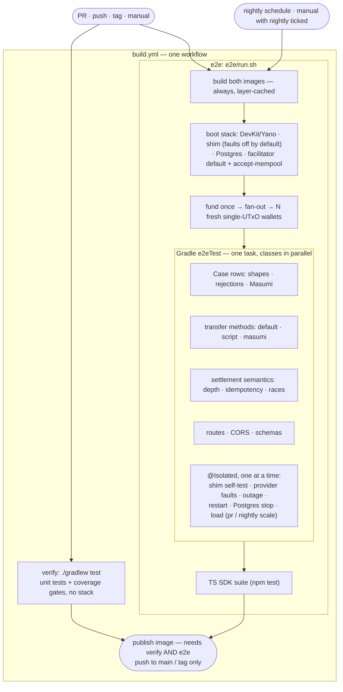

# Test pipeline — target state

**Status:** implemented except: (1) no run of `build.yml` on GitHub yet, so the CI timings and the
nightly legs are unproven; (2) branch protection on the new checks (`verify`, `E2E (devnet, pr)`), a
user step once there are about 10 green runs; (3) "ledger rejects" is tested with a synthetic
Blockfrost-wrapped error body, not text captured from a real cardano-node (the DevKit image has none);
(4) the swallowed-submit row stays `settlement_pending` forever, the open finding below, pinned
as "never rebroadcast" only. Implementation plan, change map, risks and acceptance criteria:
[2026-11-04-test-pipeline-implementation.md](2026-11-04-test-pipeline-implementation.md).
**Today:** measured locally on 2026-11-05/06, not in CI: a fresh full `E2E_SKIP_BUILD=1 e2e/run.sh`
takes 10 min 14 s with 176 Java tests and 6 TS tests; the Java suite ran in 6 min 25 s before the kit
parallelised it and in about 2 min 25 s after (before the chaos, fault and load classes were added).
CI is not yet measured.

## Summary

There is one way to do each thing:

| To… | Use |
|---|---|
| run without a devnet | `./gradlew test` — unit tests **and** the coverage gates |
| run on the devnet | `e2e/run.sh` — boots the stack, runs the Java suite (`e2eTest`), then the TS SDK suite |
| add a transaction case | one `Case` row in a Java table: build spec · optional defect · expected result |
| keep a disruptive test apart | `@Isolated` on its class, so nothing runs alongside it |
| run CI | one workflow, `build.yml`: verify · e2e · publish (publish waits for both); a nightly `schedule` runs the same e2e at full load scale plus a canary on the latest SDK and DevKit |

A fault-injecting shim between the facilitator and Yano reaches the failure paths that a
healthy devnet can't produce. The TS suite stays separate only because it tests the
published JS SDK.

## Diagram — how the tests run

**How a single case runs** (every devnet transaction case is a `Case` row):
1. **Take** a pre-funded single-UTxO wallet from the fan-out.
2. **Build** with `PaymentFactory.Spec`: `customize(Tx)` for extra intents, `preBalance` for body fields QuickTx's `Tx` lacks, and `nonceInput` to choose the nonce.
3. **Break it**, only if the row has a defect: a transaction mutation or an envelope edit.
4. **Wrap** it in the x402 envelope.
5. **Call** `/verify`, then `/settle`.
6. **Assert:**
   - the expected result (`SETTLED` or the exact code and message);
   - the response matches the JSON schema;
   - the transaction is on-chain, found by its locally computed hash;
   - the shim's submit count for that hash is exactly 0 or 1.

## Transaction catalogue — what gets tested

✓ = implemented and passing on the devnet · ✓* = implemented with a caveat (named in the row). "Row" = a `Case` row in a Java table.

### 1. Valid payments that must settle

| Transaction | Method | Built as | Today |
|---|---|---|---|
| ADA to payTo + change | default | row, TS | ✓ |
| Native token | default | row, TS | ✓ |
| With auxiliary metadata | default | row | ✓ |
| Overpayment | default | row | ✓ |
| PlutusV3 lock · V2 with inline datum · V3 with applied params · script-hash-only | script | row (V3 also TS) | ✓ |
| ADA lock · token lock into the allowlisted escrow | masumi | row, TS | ✓ |
| Several inputs, nonce is **not** the first input | default | row (`collectFrom`, `nonceInput(1)`) | ✓ `ShapeMatrixE2ETest` |
| Enterprise-address payer | default | row | ✓ `ShapeMatrixE2ETest` |
| payTo output also carries another token | default | row | ✓ `ShapeMatrixE2ETest` |
| Script payment with a **datum hash** | script | row | ✓ `ShapeMatrixE2ETest` |
| Uppercase nonce | default | row (payload edit) | ✓ `ShapeMatrixE2ETest` |

### 2. Valid but unusual shapes — rejected, because no phase-1 validator ships

Any body field outside `plainKeys`, or any script witness, goes to the phase-1 validator
path; with none configured it is `phase1_invalid` (`ExactCardanoScheme.java:218-231`).

| Payment plus… | Body key | Expected | Today |
|---|---|---|---|
| stake withdrawal | 5 | `invalid_exact_cardano_payload_phase1_invalid` | ✓ `ShapeMatrixE2ETest` |
| stake registration certificate | 4 | `…_phase1_invalid` | ✓ `ShapeMatrixE2ETest` |
| mint | 9 | `…_phase1_invalid` | ✓ `ShapeMatrixE2ETest` |
| reference input | 18 | `…_phase1_invalid` | ✓ `ShapeMatrixE2ETest` |
| bare native-script witness | witness set | `…_phase1_invalid` | ✓ `ShapeMatrixE2ETest` |
| payTo paid in two half outputs | — | `invalid_exact_cardano_payload_amount_insufficient` (one output must carry the amount) | ✓ `ShapeMatrixE2ETest` |

### 3. Deliberately broken transactions — rejected with the exact code

| Group | Rows | Today |
|---|---|---|
| Envelope: scheme, method, network, empty / malformed / foreign / spent nonce, spent 2nd input | 9 | ✓ |
| Requirements: amount 0 or leading zero, timeout 0, asset, policy, payTo on mainnet | 7 | ✓ |
| Decoding · size (protocol max, 32 KiB cap) | 2 + 2 | ✓ |
| Signatures: unsigned, witness not covering body, stranger | 3 | ✓ |
| Network id: body, output | 2 | ✓ |
| Phase 1/2: duplicate input, required signer, script input, `is_valid=false` | 4 | ✓ |
| Validity: ttl passed, too far, not yet valid, no ttl | 4 | ✓ |
| Value: outputs > inputs, fee too low, below min-UTxO | 3 | ✓ |
| Recipient, asset, amount | 3 | ✓ |
| Script: wrong address, PlutusV1 | 2 | ✓ |
| Masumi: terms, signatures, deployment, datum, deadlines, collateral, escrow outputs | 23 | ✓ |
| **Same Masumi terms in a second transaction** → `duplicate_settlement` (scenario test) | 1 | ✓ `MasumiTermsConflictE2ETest` |

### 4. Valid transaction, misbehaving provider — the shim injects faults

| Fault | Expected facilitator behaviour | Today |
|---|---|---|
| Shim paused (full outage) | degrades, recovers | ✓ |
| Submit forwarded, **response lost** | pending, no second broadcast | ✓ `ProviderFaultE2ETest` |
| Ledger rejects with cardano-node error text | `settlement_definitively_rejected` | ✓* `ProviderFaultE2ETest`; the body is synthetic, not captured from a node |
| Submit swallowed (accepted, never forwarded) | pending, no rebroadcast; never expires with Blockfrost (open finding) | ✓ `ProviderFaultE2ETest` (pins "never rebroadcast" only) |
| UTxO without a lovelace entry | `input_value_unavailable` | ✓ `ProviderFaultE2ETest` |
| Tx reported in mempool, `l1Confirmations: -1`, accept-mempool off | waits for inclusion — failed before WP-15 (the `-1` depth bug), passes now | ✓ `MempoolEvidenceE2ETest` |
| Confirmed tx disappears (rollback) | pending, no rebroadcast; confirmed again when it reappears | ✓ `ProviderFaultE2ETest` |
| 429 from provider on lookups | `chain_lookup_failed`, retryable | ✓ `ProviderFaultE2ETest` |
| Provider refuses the submit | Unknown outcome → pending. `settlement_failed` can't be produced deterministically and stays excluded. | — |

### 5. Valid transaction, concurrency and a misbehaving process

| Event | Expected | Today |
|---|---|---|
| Two concurrent settles of one payment | one broadcast, both succeed | ✓ `SettlementSemanticsE2ETest` |
| Re-settle the same payload / same tx with other requirements | idempotent / `duplicate_settlement` | ✓ `SettlementSemanticsE2ETest` |
| Facilitator restarted mid-settle (`@Isolated`) | journal resumes, reconciler confirms, no second broadcast | ✓ `CrashRecoveryE2ETest` |
| Postgres stopped (`@Isolated`) | fails closed: no broadcast, no success, readiness DOWN (within 45 s: Hikari's 30 s connection timeout); recovers | ✓ `CrashRecoveryE2ETest` |

### 6. Load (`LoadE2ETest`, `@Isolated`; `E2E_LOAD_SCALE=pr` on every run, `nightly` on schedule)

| Profile | Transactions | Checks |
|---|---|---|
| Verify burst | 1 valid payment × up to 32 (pr) / 128 (nightly) simultaneous calls | error rate per code, readiness flaps, latency |
| Settle mix | weighted `SETTLED` rows (ADA · token · Masumi · shapes) at a fixed arrival rate | every success on chain exactly once, ≤ 1 submit per hash, every on-chain hash reaches CONFIRMED (other stuck rows reported) |
| Duplicates | 5 % re-sent settled payments | no second broadcast |
| Chain profile | during the verify burst, the shim adds ~150 ms latency + a Blockfrost-style rate limit (10/s) on reads | rate-limited lookups fail closed as `chain_lookup_failed` (reported, not failed). The lookup-pool wait itself (WP-16) is proven by a latency-only burst |

## Open finding

A submission the provider accepted but that never reaches a block stays `settlement_pending`
forever: Blockfrost-compatible providers give no watermark, so expiry can never be proven.
See "Findings for you" in the implementation plan.
